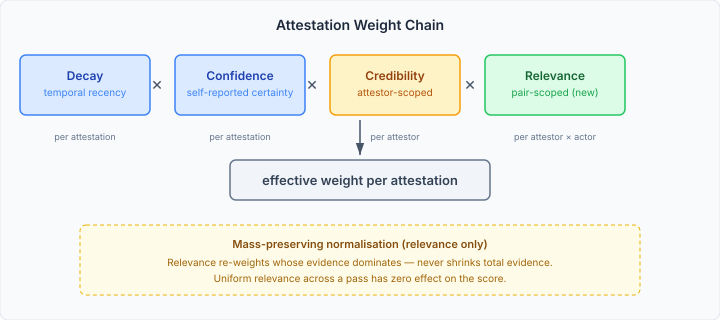

# The Weight That Knows Where You Sit

The trust computation in casehub-ledger has had three weight factors since the beginning: how recent the attestation is (decay), how certain the attestor was (confidence), and how credible the attestor is in general (credibility). Each factor asks a different question. Decay asks *when*. Confidence asks *how sure*. Credibility asks *how reliable is this judge*.

None of them ask *how relevant is this judge to this particular actor*.

That's the gap. An attestation from a same-unit peer — someone who shares your tools, your training data, your operational context — carries different information than one from an agent three org hops away. The close peer understands the domain constraints. The distant peer provides independence. Both matter, but they matter differently.

## Accuracy vs Independence

This is a genuine tension, not a tradeoff to optimise away.

Shared operational context makes judgments more informed. Same-unit agents see the same failure modes, understand the same constraints, know what "good" looks like in this specific domain. Their attestations are more *accurate*.

But shared context also means correlated judgment. Same-unit agents share biases, tools, prompts. When three agents in the same unit all attest SOUND, that might be three independent validations — or one validation echoed through shared training. Cross-unit attestations provide genuinely independent signals that catch failure modes the close peers all share.

The design we landed on is accuracy-biased by default: same-unit attestations receive more weight. The rationale is straightforward — most deployments start without adversarial agents, and close peers genuinely do know better. But the architecture doesn't bake that assumption in. The factor pipeline (more on this below) lets any deployment contribute an independence-biased factor alongside the proximity one.

## The Pair-Scoped Distinction

The existing credibility SPI asks one question: *how reliable is attestor Y in general?* Its signature — `assess(attestorId)` — reflects that. Credibility is a property of the attestor, full stop.

Relevance is different. It's not about Y alone — it's about Y's relationship to X, the actor being scored. The same attestor can be highly relevant for one actor (same unit, shared capability) and irrelevant for another (different domain, no shared context). This is an inherently pair-scoped concept.

```java
public interface AttestationRelevanceFactor {
    RelevanceAssessment assess(AttestationRelevanceContext ctx);
    String name();
}
```

The context record carries everything a factor needs: attestor identity, scored actor, tenancy, capability, dimension, timing, and a write-time snapshot map. The snapshot map is the extensibility mechanism — each enricher writes its own keys, each factor reads its own. Adding a future factor (capability overlap, collaboration recency) requires only a new enricher and a new factor bean. No schema changes in ledger. No record changes.

## Why Write-Time Snapshots

I considered computing org distance at trust-computation time — query the org tree, get the distance, apply the weight. It's simpler. It's also wrong.

Org structures change. Agents move between units. If I compute distance at read time, a reorg retroactively rewrites trust history. An attestation by a same-unit peer — someone who genuinely shared your context when they reviewed your work — becomes "cross-unit" the moment they transfer. The trust score changes with no new evidence. For a system that aims at EU AI Act Article 12 auditability, that's disqualifying.

The design captures org distance when the attestation is written, as a JSON snapshot on the attestation record. The relevance factor reads the snapshot — a pure function of ledger data, no I/O on the read path. The three `TrustScoreSource` strategies (Materialized, Cached, Computed) all see the same snapshot and produce the same score. Deterministic. Auditable. Reproducible from the ledger alone.

The JSON snapshot (`relevance_snapshot TEXT`) follows the supplement pattern already used for entry data. Each enricher writes its own keys — `{"org-distance": 2}` for the proximity enricher. Future enrichers add their own keys without touching the schema.



## Mass-Preserving Normalisation

The naive approach — multiply each attestation's weight by its relevance factor — has a subtle problem. Any uniform discount reduces total evidence mass, pulling Beta scores toward the 0.5 prior. An actor reviewed entirely by cross-unit peers (all at 0.7 weight) would score 5.5% lower than the same performance attested by in-unit peers, with no difference in actual quality. The gap comes from org topology, not from performance.

Mass-preserving normalisation fixes this. The normalisation factor is computed per pass: `Σ(base_mass) / Σ(base_mass × relevance)`. Multiply every relevance weight by that factor, and the total evidence mass is unchanged. Relevance shifts *whose* evidence dominates — same-unit peers count proportionally more — without shrinking the total.

The key invariant: if every attestation in a pass has equal relevance, the score is unchanged vs no relevance. Uniform proximity has zero effect. Only differences in relevance between attestors matter.

One thing worth being direct about: normalisation amplifies in-unit influence. That's the intended accuracy bias, not a bug. But it does widen the anti-gaming gap — a unit of agents whose positive attestations correlate will produce higher trust scores than the same performance attested cross-unit. An independence-aware factor (a cap on same-unit share of a group's mass) is the natural mitigation, contributed through the same factor pipeline.

## The Factor Pipeline

The design doesn't hardcode org proximity as the only relevance signal. `RelevanceComposer` iterates every `AttestationRelevanceFactor` bean on the classpath, computes the product of their weights (floored to prevent compounding to near-zero), and feeds the result into the trust computation. With zero factors, everything is NEUTRAL — backward-compatible.

The org-proximity factor itself ships from eidos, not from ledger. Ledger has zero eidos dependency — not even a type reference. The factor activates by classpath presence, following the same pattern as the credibility SPI. Org knowledge stays in the module that owns the org model.

This matters for future extensibility. Capability overlap — where an attestor's expertise in the same capability makes their judgment more relevant — is a second factor that can plug into the same pipeline. Collaboration recency — where agents who recently worked together on the same task have direct evidence — is a third. Each is an independent bean, contributed by whatever module owns the data.

The write-time snapshot makes all of this practical. Each factor's enricher captures whatever context it needs at attestation time. Each factor reads its own keys from the snapshot at computation time. No cross-module coupling. No runtime I/O. No retroactive history rewriting.
