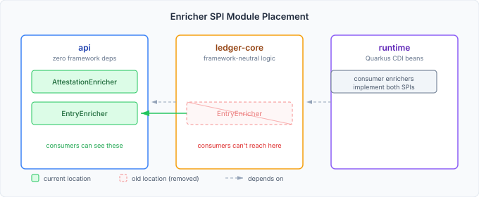

# The Interface That Lived Next Door

`LedgerEntryEnricher` has lived in `ledger-core` since it was extracted from a monolithic `@PrePersist` body back in April. It worked fine there. `ledger-core` is framework-neutral, sits between `api` and `runtime`, and the enricher pipeline runs inside the core logic. Reasonable placement.

Then we built `LedgerAttestationEnricher` — the sibling interface for attestation write-time hooks — and placed it in `api`. The reasoning was straightforward: eidos (a downstream consumer) depends only on `ledger-api`, and it needs to implement attestation enrichers to populate org-distance snapshots for the relevance pipeline. If the SPI lives in `ledger-core`, eidos can't see it without taking on a dependency it shouldn't need.

The moment the attestation enricher landed in `api`, the entry enricher's placement looked wrong.

## The Visibility Problem

The module dependency chain runs one way: `api` ← `ledger-core` ← `runtime`. A consumer that depends on `ledger-api` can implement any interface defined there. A consumer that depends only on `ledger-api` cannot see anything in `ledger-core` — that's the point of the layering.

`LedgerEntryEnricher` was an SPI. The consumer guide explicitly told people to implement it: "Consumer enrichers: implement `LedgerEntryEnricher`, annotate with `@ApplicationScoped` and `@Priority`." But the interface lived in `ledger-core`, not `api`. Any consumer that wanted to write an enricher needed a dependency on `ledger-core` — a module that contains internal implementation details like `TrustScoreComputer` and `RelevanceComposer`. That's the wrong trade: visible implementation details as the price of implementing a public SPI.

It didn't matter until now because the only consumers (casehub-work, casehub-qhorus) already depend on `ledger-core` for other reasons. The visibility problem was latent.

## What the Move Tells You

Moving `LedgerEntryEnricher` from `io.casehub.ledger.core.enricher` to `io.casehub.ledger.api.spi` touched fourteen files. Every one of them was an import change — the interface contract didn't change at all. The move also added a `String name()` method to match `LedgerAttestationEnricher`'s diagnostics convention, which surfaced eight production classes and three test records that needed implementations. All returning short kebab-case identifiers: `"trace-id"`, `"actor-did"`, `"provenance-capture"`.

The refactoring was mechanical. The insight wasn't.

The pattern is general: when you build a second interface in the same family and place it correctly, the first interface's placement becomes a defect. The sibling reveals what the original got wrong. This is a stronger signal than a code review finding — it's the design itself telling you where the boundary should be. An SPI that consumers implement belongs where consumers can see it, regardless of where the pipeline that iterates it runs.

Both enricher SPIs now live side by side in `api/spi/`. The pipeline implementations that iterate them (`EnricherPipelineCore`, `AttestationEnricherPipelineCore`) stay in `ledger-core` where they belong — internal wiring, not consumer-facing contracts. The separation is clean: the shape of the hook is public, the machinery that runs it is private.

ADR 0018 documents the broader attestation relevance architecture that prompted this move. The enricher placement is a footnote in the ADR, but it's the kind of footnote that matters — the one where the system's internal coherence improved without anyone asking for it, simply because the new feature made the inconsistency visible.
