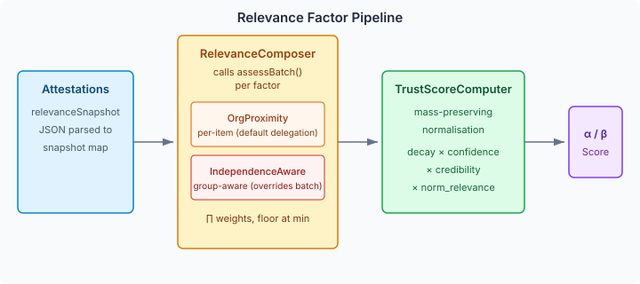

# The Cap That Keeps the Crowd Honest

The org-proximity factor does exactly what it's supposed to. When an attestor works in the same unit as the actor they're reviewing, their judgment carries more weight — they share tools, context, and domain knowledge. Same-unit attestors are more accurate. The weight table reflects that: distance 1 gets full weight, distance 3 gets 0.65.

The problem isn't accuracy. It's what happens when accuracy is the only signal.

## The Amplification Problem

Consider an actor with eight attestations: six from the same unit, two from outside. Without relevance weighting, all eight contribute equally to the trust score. With org-proximity weighting, the six close peers get full weight while the two outsiders get discounted. After mass-preserving normalisation, the six now dominate the evidence mass.

This is correct if the six close peers are genuinely independent observers. It's wrong if they share training data, work on the same tickets, and reach similar conclusions for reasons that have nothing to do with the actor's actual quality.

Correlated positive attestations from the same unit produce higher trust scores than the same performance attested cross-unit. The ARC42 active risks table calls this the in-unit amplification gap. The floor on relevance weight (default 0.5) bounds the worst case, but it doesn't address the structural problem: when one unit contributes most of the evidence, their shared biases go unchallenged.

## Group-Level Reasoning

The standard `AttestationRelevanceFactor` SPI is per-attestation — `assess(ctx)` returns a weight for one attestation at a time. That's fine for org-proximity, where the question is "how close is this attestor to the scored actor?" Each attestation can be assessed independently.

An independence cap asks a different question: "what fraction of this computation group shares a unit?" That requires seeing the whole batch before deciding any individual weight. The SPI already had the hook — `assessBatch(List<AttestationRelevanceContext>)` existed as a default method that simply looped `assess()`. The independence factor overrides it to reason about group composition.

The `RelevanceComposer` now calls `assessBatch()` per factor instead of `assess()` per attestation. Existing per-item factors are unchanged — the default delegation handles them. Group-aware factors get the full batch and return a weight map.

## How the Cap Works

The algorithm is simple. For each computation group:

1. Classify attestations by `org-distance` from the snapshot: same-unit (distance 1), cross-unit (> 1), unknown (≤ 0 or missing snapshot)
2. Compute the same-unit share: `sameCount / (sameCount + crossCount)` — unknowns excluded from the denominator
3. If the share is at or below the cap (default 60%): all weights stay at 1.0
4. If over the cap: scale same-unit weights down by `cap × crossCount / ((1 − cap) × sameCount)`, cross-unit stays at 1.0

The formula produces exact results when the independence factor is the sole factor. Under composition with org-proximity, the effective share deviates from the configured cap — but mass-preserving normalisation preserves total evidence mass regardless.

Two guard clauses prevent degenerate cases. When all attestations are same-unit, there's nothing to protect — no cross-unit minority exists, so all weights stay neutral. When all attestations are cross-unit, the cap never triggers. In both cases the factor is a no-op, which is the right behaviour: the cap exists to protect diverse groups from being dominated by a majority, not to penalise uniform groups.

## The Accuracy–Independence Spectrum

The two factors compose through the same pipeline. Org-proximity boosts same-unit attestors (accuracy bias). The independence cap limits how much of a group's evidence mass they can dominate (independence bias). They multiply — the product is floored at the minimum relevance weight to prevent compounding to near-zero.

This isn't a tension that resolves. Accuracy and independence are genuinely in conflict: the same operational context that makes an attestor's judgment better informed also makes their judgments correlated. The factor pipeline lets you dial both biases independently. The default configuration — full accuracy boost with a 60% independence cap — reflects a deliberate choice: trust close peers more, but not so much that they crowd out the outsider's signal.

The mechanism is worth highlighting because it's the kind of thing that looks simple in code (one class, one override, one config key) but is load-bearing in production. Without the cap, any deployment where agents cluster into units will see trust scores drift toward the in-unit consensus — which may or may not reflect reality. With it, cross-unit attestations retain a minimum floor of influence regardless of how outnumbered they are.
